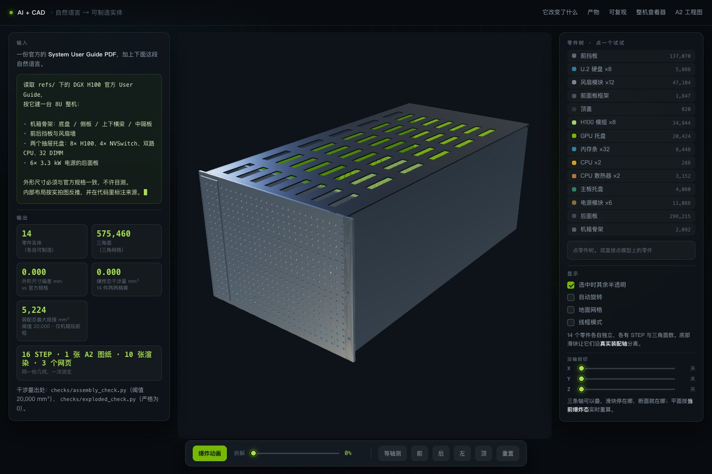
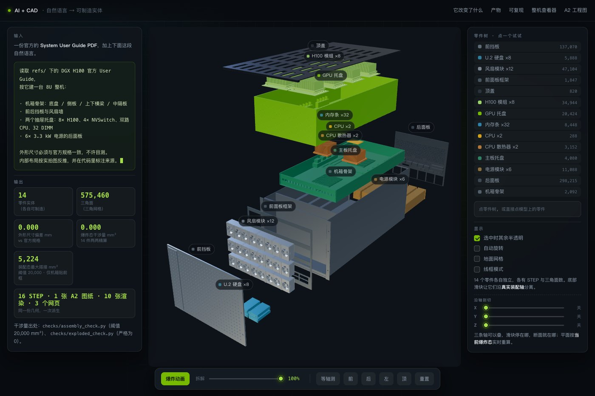
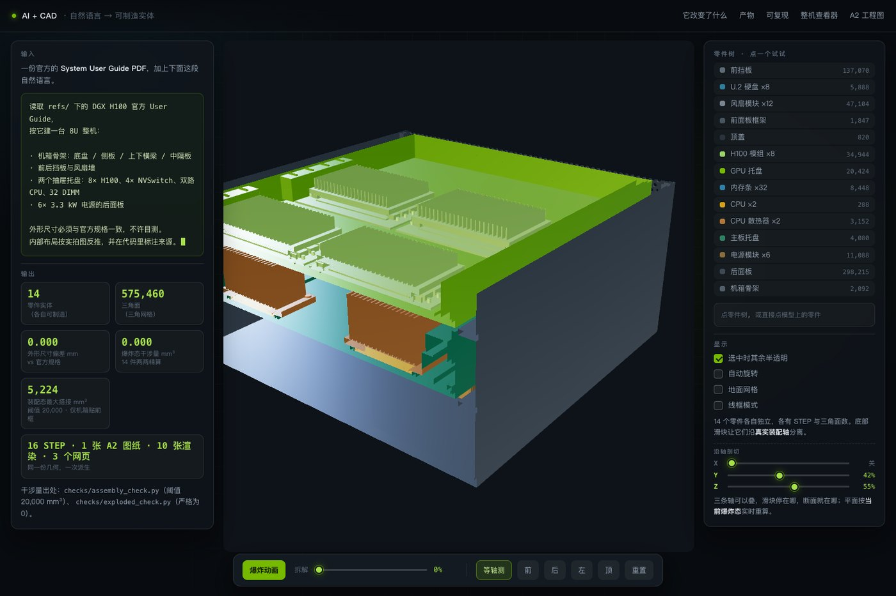
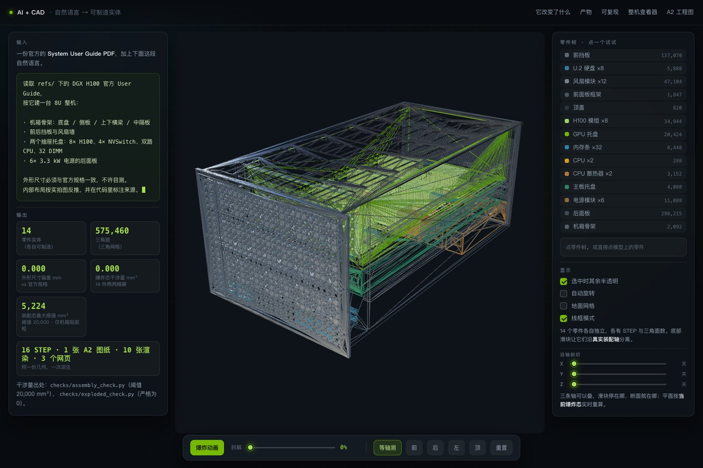
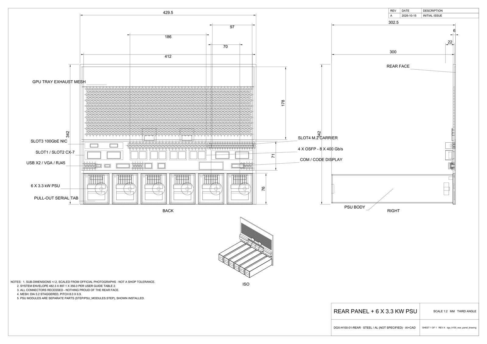

# CAD Showcase Studio

> 把一份 CAD 几何，做成浏览器里能转、能拆、能剖开看的交互页面 —— 外加工程图和讲解影片。
>
> 这是一个给 AI Agent 用的技能包（Agent Skill），不是一次性脚本。本仓库是它的完整操作规程、
> 可复用脚本与实战踩坑记录。

| 装配态 | 爆炸分解 |
|:-:|:-:|
|  |  |
| **三轴剖切** | **线框模式** |
|  |  |

▶ [观看拆解动画（MP4，2.6 MB，51 万面逐帧渲染）](assets/demo-explode.mp4)

---

## 它解决什么问题

从「我想要一个能在网页里拆开看的服务器」到真正拿到产物，中间隔着五件事：建模、分件导出、
前端交互、工程图、影片。大多数人卡在第二件——把零件合并成一个实体，再想拆就拆不开了。

这套流程把对象**只建模一次**，从同一份参数化几何派生出五类产物：

| 产物 | 形态 | 怎么来的 |
|---|---|---|
| 逐件 STEP 实体 | `STEP/*.step` | 一零件一脚本，参数来自 `src/lib/params.py` |
| 三角网格 | `MESH/parts/*.glb` + `manifest.json` | 逐件导出，面数/包围盒由脚本实测回填 |
| 交互展示页 | 单文件 HTML | 读 manifest，爆炸 / 拾取 / 剖切 / 线框 |
| 工程图 | `PDF/*.pdf` | 从 STEP 自动投影出视图与尺寸 |
| 讲解影片 | `RENDER/*.mp4` | 无头浏览器逐帧抓图 + 配音合成 |

**所有尺寸、标注、面数都由脚本从几何里量出来，不手填。** 改一个参数，五类产物同时更新。

---

## 为什么这个技能值钱：AI 生成 3D 的失败模式不报错

用 AI 做 3D 页面，最常见的困境不是「跑不起来」，而是「看起来不对」：

- 爆炸之后有一半零件不见了 —— 因为没有报错，只是不见了
- 模型永远只占半屏 —— 因为取景框用了分解态下并不存在的包围盒角点
- 剖开之后断面只剩右下角一小块 —— 因为取景算了被裁掉的点
- 零件点不动、点不出来 —— 因为建模时合并成单 mesh，零件树根本不存在

这些问题的共同点是**没有任何一条会抛出异常**。所以本技能的核心不是代码，是
[`SKILL.md`](SKILL.md) 里那十二条硬约束——每一条都对应一次真实的可复现故障，
多数违反之后只在画面上表现为「感觉不太对」。

---

## 安装

这是一个 [Agent Skill](SKILL.md)：`SKILL.md` 是主入口，`references/` 按阶段按需加载，
`scripts/` 是可执行工具。采用通用的 Agent Skill 格式（YAML front matter + Markdown + 附属文件），
支持同类规范的客户端都能复用。

**WorkBuddy**（技能目录）：

```bash
git clone https://github.com/Aihua96/cad-showcase-studio.git \
  ~/.workbuddy/skills/cad-showcase-studio
```

克隆后**重开会话**，技能才会出现在可用列表里。其他客户端放到各自的 `skills/` 目录即可，
`SKILL.md` 的 `name` 字段需与目录名一致。

**只想看方法论、不装技能**：直接读 [`SKILL.md`](SKILL.md) 和 `references/` 下的五个文档，
它们是独立的操作规程，不依赖任何代码。

---

## 快速开始

```bash
# 1. 建项目骨架：8 个目录 + params 模板 + 零件清单模板 + checks 模板
python scripts/scaffold_project.py my-object --root ~/work

# 2. 逐件导出 GLB 后，扫统计并生成 manifest（会校验分解向量与实测包围盒是否一致）
python scripts/glb_stats.py \
  --dir MESH/parts --spec tmp/parts_spec.json --out MESH/parts/manifest.json
```

`glb_stats.py` 干的事很朴素，但它是这类项目里返工最少的一处改动：把三角面数、包围盒、
分解位移从「手抄数字」变成「实测值」，不一致直接报错退出。

---

## 六阶段

| 阶段 | 输入 | 产物 | 出口判据 |
|---|---|---|---|
| 0 规格化 | 图纸或照片、讲给谁听、精度档 | 尺寸来源表、分解顺序表、零件清单 | 每件有名字、有方向，每个尺寸标了来源 |
| 1 几何 | 尺寸表 | `src/lib/params.py` + 零件脚本 | 总装外形与图纸值偏差为 0 |
| 2 分件导出 | 零件脚本 | STEP + GLB + manifest | 零件数、面数、包围盒全部写进 manifest |
| 3 展示页 | manifest + 文案 | 单文件 HTML | 无头探针全绿 |
| 4 工程图 | STEP | A2 PDF | 尺寸由内核量出，视图不出框、文字不切 |
| 5 影片 | 分镜 + 配音 | MP4 | 时长对齐真实起句，无死帧、无裁字 |
| 6 验收 | 全部产物 | 检查脚本 + 截图 | 外观 / 干涉 / 探针 / 线上 md5 四项都过 |

**阶段 0 决定后面全部返工量。** 分解方向不是随手写的：机械按装配轴和维护顺序，
建筑按楼层与系统，桥梁按施工逆序。先定这张表，再动手建模。

---

## 十二条硬约束（摘选）

完整十二条见 [`SKILL.md`](SKILL.md)，这里只列最容易致命的六条：

1. **零件绝不能 union 进面板。** 一个 STEP 只导出一个 mesh 节点，合并了就永久分不开，
   零件树不存在，干涉自检还会全返回 0。事后补不回来。
2. **取景用逐件真实角点，不用并集包围盒的 8 个角。** 分解态下那 8 个角有 4 个现实中不存在，
   为照顾不存在的角落只能把相机退很远——这是「模型只占半屏」的真正原因。
3. **剖切平面常驻不增删，只改 `constant`。** `clippingPlanes` 一改长度就重编译 shader，
   几十个材质会卡顿。关闭时把常数写到 `1e3`，别写「盒外 5%」——爆炸后会有一半零件被剪掉。
4. **平面常数必须按当前分解态重算。** 否则机器一散开，前半截零件整片消失。
5. **验收必须落在 GPU 真正消费的参数上。** 前端自己算一份、GPU 再算一份的几何效果
   （剖切、透明度、雾）极易两套判据不一致：前端说「保留」，GPU 已经切掉了，探针全绿而画面是错的。
6. **单文件页面的资源必须内嵌。** `file://` 下 fetch 与 ES module 都被 CORS 拦，
   外置 `.glb` 打不开。GLB 走 gzip + base64 内嵌，压缩率约 22%。

---

## 实战验证：DGX H100 8U 服务器

这套流程的第一个完整项目，也是本技能的来源。

| 指标 | 结果 |
|---|---|
| 模块数 | 14 件，逐件独立 STEP / GLB |
| 外形尺寸 | 482.300 × 897.100 × 356.000 mm，与官方手册**偏差 0.000 mm** |
| 三角面 | 575,460（软件渲染逐帧抓图约 5.4 s/帧） |
| 分解态干涉 | **0.000 mm³** |
| 单文件展示页 | 7.05 MB，含全部几何与前端代码，双击即开 |
| 页面探针 | 零件数 / 拾取 9/9 / 分解 / 剖切像素 / 线框 / 重置 / 无 pageerror 全绿 |

线上演示：<https://dgx-h100-teardown.app.workbuddy.host/?sharecode=FQYAFSITNG>

| 工程图（A2，尺寸由内核量出） |
|:-:|
|  |

---

## 换成别的对象

同一套流水线，四种对象的差别集中在四件事：**分解语义、精度档、面数预算、构件树结构**。

| 对象 | 分解语义 | 面数预算 | 构件数 | 真正好用的功能 |
|---|---|---|---|---|
| 机架设备 | 沿装配轴平移，与维护手册一致 | 50 万 | 10–20 | 分解 + 点选 + 后视图 |
| 机械结构 | 沿配合面 / 螺栓方向分离 | 60 万 | 10–80 | 分解 + 剖面 |
| 建筑 | 按楼层自下而上，或按系统 | 30 万 | 50–300 | **剖切** + 分层 |
| 桥梁 | 施工逆序：桩基→承台→墩身→支座→主梁→桥面→拉索 | 80 万 | 50–500 | **剖切** + 施工顺序 |

**建筑和桥梁的「爆炸图」在专业语境里不常用**，叫「分层」或「施工顺序」更自然。
真正有说服力的是剖面——建筑剖面图、桥梁横向布置图本来就是这两个专业的核心表达，
剖切功能迁过去收益最大。

图纸的接入方式与尺度切换清单见 [`references/object-types.md`](references/object-types.md)。
一句话：**图纸省掉的是最贵的「反推尺寸」环节，但不会自动变成模型**——仍需读轮廓、
写几何脚本，只是尺寸不再靠估。

---

## 目录结构

```
SKILL.md                  主入口：六阶段 + 十二条硬约束 + 引用索引
references/
  geometry.md             建模规范、尺寸溯源四档、坐标约定、cadgen 环境与命令
  showcase.md             manifest 数据契约、取景/剖切/内嵌实现细节、右栏空间预算
  film.md                 分镜时间轴、逐帧抓图、配音与读音校验
  acceptance.md           三层验收：几何自检 / 页面探针 / 线上部署校验
  object-types.md         机械·机架·建筑·桥梁的分解语义与尺度切换清单
scripts/
  scaffold_project.py     建项目骨架（8 目录 + 5 模板）
  glb_stats.py            扫 GLB 生成 manifest，校验分解向量与包围盒
assets/                   效果图与拆解动画
```

---

## 依赖与环境

技能本身是文档 + 两个纯 Python 脚本（无第三方依赖）。**跑完整流水线**需要：

| 用途 | 依赖 | 说明 |
|---|---|---|
| 几何建模与 STEP 导出 | [`cadgen`](https://pypi.org/project/cadgen/) 0.7.21 | 建议用 `uvx` 隔离运行；内部单位为米 |
| GLB 导出 | Node.js + cadgen 的 mesh exporter | 注意某些环境会注入 `NODE_OPTIONS` 拦截导出，需 `os.environ.pop` |
| 前端打包 | esbuild + three.js | 打成 IIFE 单文件 |
| 工程图 | cadgen 的 `engineering-drawing` 能力 | 需要 `MPLCONFIGDIR` 环境变量 |
| 影片合成 | ffmpeg + puppeteer | 无头 Chromium 逐帧抓图 |

这些依赖的**具体版本、调用写法和已知坑**都记在 `references/` 对应文档里，
包括「软件渲染 5.4 s/帧，先探针测速再定帧数」这类只在实战中才会知道的事。

---

## License

[MIT](LICENSE) © 2026 Aihua96

---

<details>
<summary><b>English</b></summary>

**CAD Showcase Studio** is an agent skill that turns a single parametric CAD model into five
deliverables: per-part STEP solids, triangle meshes, a single-file interactive web page
(exploded view, part picking, tri-axis sectioning, wireframe), A2 engineering drawings, and a
narration film.

The value is not the code — it's the twelve hard constraints in `SKILL.md`. Each one maps to a
reproducible failure that **throws no error**: parts silently disappear after exploding, the model
only fills half the viewport, sections render as a corner sliver, parts become unpickable. Written
from a real project (NVIDIA DGX H100 8U, 14 parts, 575k triangles, 0.000 mm dimensional deviation),
and the decomposition semantics generalize to machinery, buildings and bridges.

</details>
